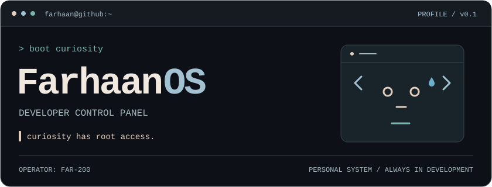

<!-- FarhaanOS: static profile dashboard. Version labels and process states are decorative. -->
<picture>
  <source media="(prefers-color-scheme: light)" srcset="assets/farhaanos-light.svg">
  
</picture>

# Farhaan Khan

**Developer in Development™**  
Developer tools · AI-assisted systems · Questionable experiments

<p>
  <a href="https://farhaankhan.dev/"></a>
  <a href="https://www.linkedin.com/in/farhaan-khan-dev"></a>
  <a href="https://x.com/FarKh_Nhi"></a>
  <a href="https://leetcode.com/u/Farhaan_2004/"></a>
</p>

Building things that usually begin with **“let me just try this.”**  
Sometimes they even survive. 🫠

## `01 /` Currently running

`DSA` · `System design` · `Backend engineering` · `Developer tooling` · `Agent experiments`

Currently building **Think Before Code** and experimenting with **Co-Dude** while getting less suspicious of FastAPI one endpoint at a time.

## `02 /` Featured projects

### 🦆 [Think Before Code](https://github.com/Far-200/think-before-code)

**A better question beats a borrowed answer.**  
Socratic agent skills for DSA practice, starring **Quackrates** — guided questions and incremental hints instead of instant solutions.

`Agent Skills` `Prompt Engineering` `DSA`

### 🌊 [FlowTrace](https://github.com/Far-200/FlowTrace)

**Watch the code think out loud.**  
A browser-based C-like execution visualizer with a lexer, recursive-descent parser, AST, tree-walking interpreter, and live variable tracing.

`React` `Monaco Editor` `Interpreter`

### 🌲 [Folder Structure Visualizer](https://github.com/Far-200/folder-structure-visualizer)

**From “here's the folder tree” to actual folders.**  
Parses ASCII directory trees into an interactive view and generates downloadable React or Node project scaffolds with real files.

[Live demo →](https://foldervisualiser.farhaankhan.dev/) · `React` `JSZip` `Tree Parsing`

### 🧪 Co-Dude

**Two agents, isolated worktrees, one human with veto power.**  
An experimental local-first CLI coordinating Codex as implementer and Claude Code as reviewer, then handing the diff, tests, and findings back to a human.

`Python` `Git Worktrees` `AI Agents`

> AI-assisted development is part of my workflow. Project descriptions explain what the software does; the repositories contain the implementation details.

## `03 /` The lab

<details>
<summary><strong>Things that escaped the notebook</strong></summary>
<br>

- **[English Terminal](https://github.com/Far-200/english-terminal)** — deterministic English-language CLI for filesystem operations and read-only GitHub queries.
- **[PromptRouter](https://github.com/Far-200/prompt-model-suggester)** — Chrome extension that recommends an AI model based on the prompt.
- **[VoyagerPulse](https://github.com/Far-200/VoygerSim)** — deep-space telemetry simulation with error correction and BER visualization.
- **[Regex Playground](https://github.com/Far-200/Regex-Playground)** — small playground for experimenting with regex patterns.
- **[Password Strength & Crack-Time Estimator](https://github.com/Far-200/Password-Strength-Crack-Time-Estimator)** — educational password entropy and brute-force-time estimator.
- **[DevTool](https://github.com/Far-200/DevTool)** — JSON formatting and API request testing in one utility.

</details>

## `04 /` Working set

**Languages** — JavaScript · Python · C++ · Java  
**Frameworks** — React · FastAPI · Tailwind CSS  
**Tools** — Git · GitHub Actions · Vite · Monaco Editor · JSZip  
**AI-assisted workflow** — ChatGPT · Claude Code · Codex · GitHub Copilot

_Proficiency remains under construction. The warning signs are decorative. Mostly._

## `05 /` Known issues

```text
[WARN] Still learning.
[WARN] Side projects may exceed original scope.
[WARN] Occasionally fixes bugs by creating different bugs.
[INFO] Curiosity has root access.
```

<details>
<summary><strong>GitHub telemetry</strong></summary>
<br>

[Contribution history](https://github.com/Far-200?tab=overview) · [Repositories](https://github.com/Far-200?tab=repositories) · [Public pull requests](https://github.com/pulls?q=is%3Apr+author%3AFar-200)


</details>

---

`farhaan@github:~$ exit`  
**Session closed. Curiosity persists.**

[Email](mailto:hello.farhaankhan@gmail.com)
