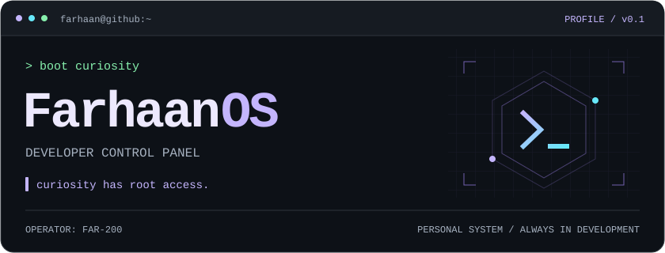

<!-- FarhaanOS: static profile dashboard. Version labels and process states are decorative. -->
<picture>
  <source media="(prefers-color-scheme: light)" srcset="assets/farhaanos-light.svg">
  
</picture>

# Farhaan Khan

**Developer in Development™**<br>
Developer tools · AI-assisted systems · Questionable experiments

<!-- Static workflow indicators, not live telemetry. -->
<p>
  
  
</p>

<p>
  <strong><a href="https://farhaankhan.dev/">Portfolio</a> · <a href="https://www.linkedin.com/in/farhaan-khan-dev">LinkedIn</a> · <a href="https://x.com/FarKh_Nhi">X</a> · <a href="https://leetcode.com/u/Farhaan_2004/">LeetCode</a></strong>
</p>

Building things that usually begin with **“let me just try this.”**<br>
Sometimes they even survive. 🫠

`FarhaanOS v0.1 / profile edition` — decorative version; still figuring out the release cycle.

[Processes](#02--currently-running) · [Projects](#03--featured-projects) · [The lab](#04--the-lab) · [Stack](#05--technology-stack) · [Telemetry](#07--github-telemetry)

## `01 /` System initialization

```text
> initializing developer...
> loading profile.................. [OK]
> attaching Claude Code............ [OK]
> attaching Codex.................. [OK]
> initializing questionable ideas.. [OK]
> sanity check..................... [SKIPPED]
> ready.
```

*A decorative boot log. The only thing running here is the joke.*

## `02 /` Currently running

| Process | State |
| :--- | :--- |
| **Think Before Code** | 🟢 `ACTIVE` |
| **Co-Dude** | 🟣 `EXPERIMENTAL` |
| DSA | 📖 `LEARNING` |
| System design | 📖 `LEARNING` |
| Backend engineering | 🔎 `EXPLORING` |
| Sleep | 💤 `SUSPENDED` |

Exploring developer and agent tooling, with an ongoing interest in secure backend engineering. Process states are editorial, not live monitoring. Sleep has filed an appeal.

## `03 /` Featured projects

<table width="100%">
  <tr>
    <td width="50%" valign="top">
      <p><code>MODULE 01</code><br><sub>SOCRATIC LEARNING</sub></p>
      <h3>🦆 <a href="https://github.com/Far-200/think-before-code">Think Before Code</a></h3>
      <p><strong>A better question beats a borrowed answer.</strong></p>
      <p>Socratic agent skills for DSA practice, starring <strong>Quackrates</strong>. Guided questions and incremental hints protect productive struggle instead of handing over the finished solution.</p>
      <p><code>Agent Skills</code> <code>Prompt Engineering</code> <code>DSA</code></p>
    </td>
    <td width="50%" valign="top">
      <p><code>MODULE 02</code><br><sub>EXECUTION TRACE</sub></p>
      <h3>🌊 <a href="https://github.com/Far-200/FlowTrace">FlowTrace</a></h3>
      <p><strong>Watch the code think out loud.</strong></p>
      <p>A C-like execution visualizer: a lexer, recursive-descent parser, AST, and tree-walking interpreter turn source code into a step-by-step trace with live variable tracking. Runs as a browser simulation, without a native compiler.</p>
      <p><code>React</code> <code>Monaco Editor</code> <code>JavaScript Interpreter</code></p>
    </td>
  </tr>
  <tr>
    <td width="50%" valign="top">
      <p><code>MODULE 03</code><br><sub>PROJECT SCAFFOLDING</sub></p>
      <h3>🌲 <a href="https://github.com/Far-200/folder-structure-visualizer">Folder Structure Visualizer</a></h3>
      <p><strong>From “here's the folder tree” to actual folders.</strong></p>
      <p>Parses typed/ASCII directory trees into a structured representation and interactive view, then generates downloadable React or Node project scaffolds with real files.</p>
      <p><a href="https://foldervisualiser.farhaankhan.dev/">Open the live demo →</a></p>
      <p><code>React</code> <code>JSZip</code> <code>Tree Parsing</code></p>
    </td>
    <td width="50%" valign="top">
      <p><code>MODULE 04</code><br><sub>EXPERIMENTAL</sub></p>
      <h3>&#129514; Co-Dude</h3>
      <p><strong>Experiment in progress.</strong></p>
      <p>An experimental local-first CLI that coordinates Codex as implementer and Claude Code as reviewer in isolated Git worktrees, then hands the diff, test results, and review findings to a human for the final call.</p>
      <p><code>Python</code> <code>Git worktrees</code> <code>AI agents</code></p>
    </td>
  </tr>
</table>

AI-assisted development is part of my workflow. These descriptions cover what the projects do; their repositories carry the implementation details.

## `04 /` The lab

*Things produced after somebody said: let me just try this.*

| Experiment | What escaped the notebook |
| :--- | :--- |
| [English Terminal](https://github.com/Far-200/english-terminal) | Deterministic English-language CLI for filesystem operations and read-only GitHub API queries. |
| [PromptRouter](https://github.com/Far-200/prompt-model-suggester) | Chrome extension that recommends an AI model based on your prompt. |
| [VoyagerPulse](https://github.com/Far-200/VoygerSim) | Deep-space telemetry simulation with error correction and bit-error-rate visualization. |
| [Regex Playground](https://github.com/Far-200/Regex-Playground) | A small tool for experimenting with regex patterns. |
| [Password Strength & Crack-Time Estimator](https://github.com/Far-200/Password-Strength-Crack-Time-Estimator) | Password analysis and entropy-based brute-force time estimates; an educational experiment. |
| [DevTool](https://github.com/Far-200/DevTool) | JSON formatting and API request testing in one utility. |

## `05 /` Technology stack

Across projects and practice; proficiency is still under construction.

<p>
  
  
  
  
</p>

| Layer | Working set |
| :--- | :--- |
| **Languages** | JavaScript · Python · C++ · Java |
| **Frameworks** | React · FastAPI · Tailwind CSS |
| **Infrastructure & tools** | Git · GitHub · GitHub Actions · Vite · Monaco Editor · JSZip |
| **AI-assisted development** | ChatGPT · Claude Code · Codex · GitHub Copilot |

## `06 /` System architecture

An illustrative workflow: I choose the tools, carry context between steps, and decide what goes into the repository. Tool roles vary by task.

```text
Human / intent + decisions
  |
  v
Planning
  ChatGPT / Claude Code / Codex
  |
  v
Implementation
  Claude Code / Codex / Copilot
  |
  v
Review
  Human + tests + AI feedback
  |
  v
Git repository
  |
  v
Software
  |
  +--> feedback --> Human
```

Manual handoffs, human judgment. The orchestration layer is mostly me switching tabs.

## `07 /` GitHub telemetry

[Contribution history & activity](https://github.com/Far-200?tab=overview) · [Repositories](https://github.com/Far-200?tab=repositories) · [Public pull requests](https://github.com/pulls?q=is%3Apr+author%3AFar-200)

Live records stay on GitHub, so this dashboard doesn't freeze a flattering number in time.

<details>
<summary>Expand optional contribution visualization</summary>


Generated by this repository's existing scheduled workflow; it may lag behind GitHub. Colors follow the generated asset's palette.

[View contribution history directly on GitHub →](https://github.com/Far-200?tab=overview) · [Check the generation workflow](https://github.com/Far-200/Far-200/actions/workflows/snake.yaml)

</details>

## `08 /` Known issues

```text
[WARN] Still learning.
[WARN] Occasionally solves bugs by
       creating different bugs.
[WARN] Small side projects may exceed
       original scope.
[INFO] Stack Overflow remains part
       of the architecture.
[INFO] Most systems eventually compile.
```

---

`farhaan@github:~$ exit`<br>
**Session closed. Curiosity persists.**

*I debug code with hope, snacks, and occasional emotional damage.*

[Email](mailto:hello.farhaankhan@gmail.com)
